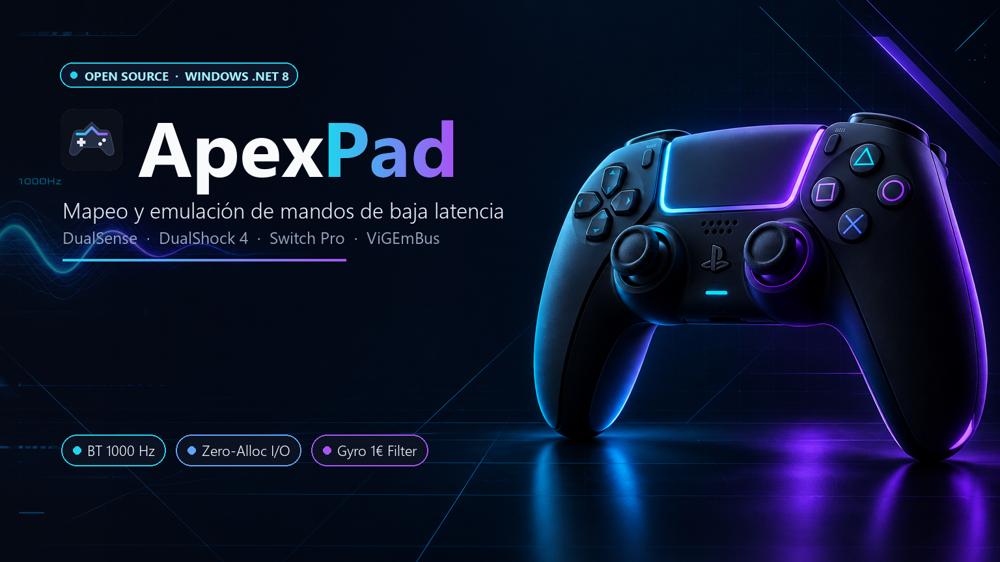

<p align="center">
  
</p>

# ApexPad

**ApexPad** es una suite avanzada de mapeo y emulación de mandos de baja latencia para Windows 10/11, desarrollada y optimizada por **Flavio Morales** ([Flavio6931](https://github.com/Flavio6931)).

Basado en el motor open-source **DS4Windows** (Jays2Kings, Ryochan7, schmaldeo) bajo licencia **GNU General Public License v3 (GPLv3)**, ApexPad introduce un núcleo optimizado de entrada/salida en tiempo real, ajustes ergonómicos para juego competitivo y aislamiento completo de datos de usuario y proceso.

## Mejoras y Optimizaciones Principales (v1.0.0)

- **Zero-Alloc HID I/O Loop:** Reuso de buffers y `ManualResetEventSlim` (`_readWaitEvent`) para minimizar asignaciones en GC Gen0 durante lecturas de alta frecuencia.
- **Copia SIMD con `Span<byte>`:** Transferencia vectorizada de reportes HID sin sobrecarga de copia tradicional.
- **Prioridad de Tiempo Real en Hilos:** Hilos de entrada con `ThreadPriority.Highest` y resolución de temporizador de Windows a **1 ms** (`timeBeginPeriod(1)`).
- **Sustained Low Latency GC:** Configuración de `GCLatencyMode.SustainedLowLatency` y liberación controlada con `TrimWorkingSet()`.
- **Auto-Ocultamiento en HidHide:** Registro automático para mitigar problemas de doble entrada (Double Input) con drivers ViGEmBus.
- **Polling Bluetooth 1000 Hz por Defecto:** Tasa de sondeo configurada a 1 ms (`DEFAULT_DS4_BT_POLL_RATE = 1`).
- **Hair Trigger en L2/R2:** Activación ultrarrápida para gatillos analógicos.
- **Vector Radial Deadzone & Anti-Deadzone:** Precisión geométrica circular mejorada y compensación de zona muerta de juego.
- **Filtro Giroscopio 1€ (OneEuro):** Suavizado adaptativo predeterminado para apuntado por movimiento sin jitter.
- **Arranque Silencioso y Tema Oscuro Nativo:** Inicialización limpia de ventana (`EnsureHandle()`) con barra de título oscura DWM (`ImmersiveDarkMode`).
- **Aislamiento Total de Entorno:** Configuración en `%APPDATA%\ApexPad`, IPC y tarea programada (`RunApexPad`) independientes, y actualizador externo deshabilitado para evitar tráfico no deseado.

## Requisitos

- **OS:** Windows 10 / Windows 11 (x64 recomendado).
- **Runtime:** [.NET 8.0 Desktop Runtime (x64)](https://dotnet.microsoft.com/en-us/download/dotnet/8.0).
- **Dependencias nativas:** Visual C++ 2015–2022 Redistributable (x64).
- **Driver virtual:** [ViGEmBus](https://github.com/nefarius/ViGEmBus/releases) (y opcionalmente HidHide / FakerInput).

## Compilación desde Código Fuente (32 bits y 64 bits)

> Por seguridad y cumplimiento de políticas de plataforma, este repositorio contiene **únicamente código fuente** (sin ejecutables `.exe` ni archivos `.zip` precompilados).

```powershell
dotnet restore ApexPad.sln
# Compilar versión 64 bits (x64)
dotnet build ApexPad.sln -c Release /p:Platform=x64
# Compilar versión 32 bits (x86)
dotnet build ApexPad.sln -c Release /p:Platform=x86
```

Los ejecutables generados se ubicarán localmente en `ApexPad\bin\x64\Release\net8.0-windows\ApexPad.exe` y `ApexPad\bin\x86\Release\net8.0-windows\ApexPad.exe`.

## Licencia y Atribución (GNU GPLv3)

Este proyecto se distribuye bajo los términos de la licencia **GNU General Public License version 3 (GPLv3)**. Puedes consultar el texto completo en [LICENSE.txt](LICENSE.txt).

Copyright © 2026 Flavio Morales (`Flavio6931`) — **ApexPad**.
Contribuidores de ApexPad ([contributors.txt](contributors.txt)): **Flavio Morales (`Flavio6931`)** y **Antigravity**.
Construido sobre el trabajo previo GPLv3 de Scarlet.Crush Productions, InhexSTER, electrobrains, Jays2Kings, Travis Nickles (Ryochan7) y schmaldeo.
